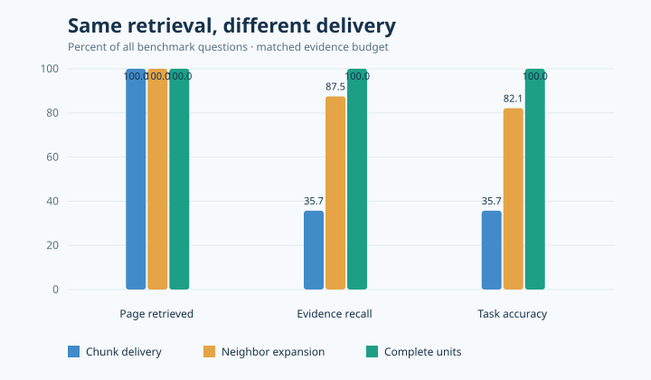
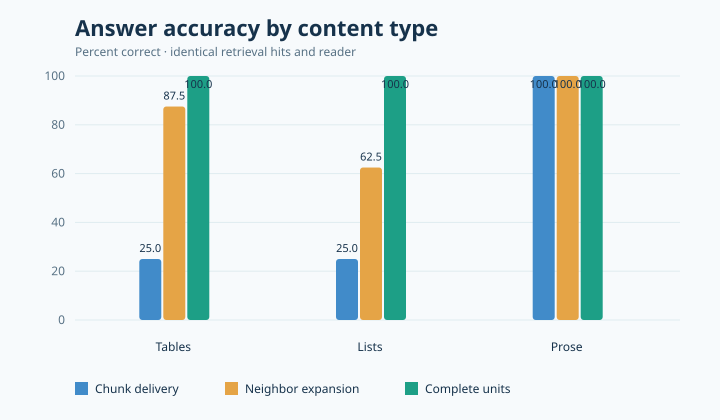
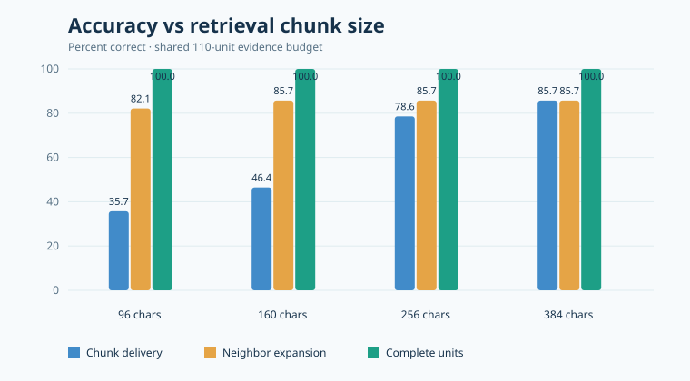

# Structure-Aware Evidence Delivery for RAG

## Problem

A retriever can find the right page and still deliver a misleading fragment to an answerer. A row such as `Premium | INR 1,000 | INR 10,000` does not say which number is the monthly limit. Likewise, a policy bullet can lose the section that identifies whether it applies to employees or contractors. **Page retrieval success is different from evidence delivery success.**

## Why obvious fixes fall short

Adding neighboring chunks helps, but it can consume the budget with other rows or put two policy sections into one ambiguous block. In this project's controlled benchmark, one-neighbor expansion raises task accuracy from **35.71% to 82.14%**, yet still answers some questions incorrectly. Raising the original chunk size from 96 to 384 characters increases the raw-chunk result to **85.71%** under the same budget. These fixes help; neither removes all errors in this corpus.

## Solution and implementation

The two versions use **the same SQLite FTS5 index, retrieved hits, question, budget, and answerer**:

1. **Version 1 — raw chunks:** Flatten HTML into text blocks, split into 96-character chunks, retrieve with FTS5, and send ranked chunks to the answerer.
2. **Version 2 — complete evidence:** Treat those same hits as pointers to source pages. Parse their HTML into table rows, list items, and paragraphs; attach the document title, heading path, table caption, and column labels; rank these self-contained units by query overlap; pack whole units within the same budget.

A third path, **neighbor expansion**, is an explicit control for the obvious fix of attaching the chunks immediately before and after each hit. Every response includes source IDs and the actual text sent to the answerer. No model training, API key, or external dataset download is needed for the default run.

## Measured results

Default run: **7 authored HTML pages, 56 fixed questions, 12 retrieved chunks at most, 110 estimated evidence tokens per answer, 96-character baseline chunks.** A conservative deterministic QA agent extracts only explicitly supported labeled values. All three paths receive the same retrieval results.

| Metric | Raw chunks | Neighbor expansion | Complete evidence |
| --- | ---: | ---: | ---: |
| Correct source page among retrieved hits | 56/56 (100%) | 56/56 (100%) | 56/56 (100%) |
| Evidence recall | 20/56 (35.71%) | 49/56 (87.50%) | 56/56 (100%) |
| Agent task accuracy | 20/56 (35.71%) | 46/56 (82.14%) | 56/56 (100%) |
| Mean delivered evidence tokens (proxy) | 52.79 | 87.11 | 89.36 |

Evidence recall counts a question only if at least one delivered unit includes the **correct entity, field label, and value in a usable relationship**. Task accuracy compares the shared agent's extracted answer against the fixed gold answer; wrong answers and abstentions are failures. The numbers above are from this **small, synthetic, exact-label benchmark**, not a general LLM result or evidence of production readiness. The budget is a transparent word-plus-punctuation proxy, not a model's tokenizer. The maximum budget is equal; actual usage varies because some paths cannot find more suitable evidence.



| Content type | Questions | Raw chunks correct | Expanded correct | Complete correct |
| --- | ---: | ---: | ---: | ---: |
| Tables | 32 | 8 | 28 | 32 |
| Sectioned lists | 16 | 4 | 10 | 16 |
| Labeled prose | 8 | 8 | 8 | 8 |





## Run locally

Python 3.10+ with SQLite FTS5 is sufficient. No `pip install` is required from the repository root.

```bash
python tools/build_benchmark.py
python -m unittest discover -s tests -v
python -m rag_evidence.cli evaluate --output results
python -m rag_evidence.cli ask "What is the Monthly refund limit for Premium?"
python -m rag_evidence.cli serve --port 8000
```

Open `http://127.0.0.1:8000/` to see the interactive comparison and recorded graphs. The JSON API is `GET /api/ask?q=What%20is%20the%20Monthly%20refund%20limit%20for%20Premium%3F`.

For an optional local LLM answerer, start Ollama with `gemma3:4b` available and use `--reader ollama --model gemma3:4b` on `ask`, `evaluate`, or `serve`. The committed results use the deterministic reader; no LLM measurements are implied by them.

## Inspect the run

| File | Purpose |
| --- | --- |
| [`results/metrics.json`](results/metrics.json) | Overall and per-type metrics, configuration, measured token usage |
| [`results/questions.jsonl`](results/questions.jsonl) | Every question, gold answer, retrieved hits, delivered evidence, predictions, correctness |
| [`results/sensitivity.json`](results/sensitivity.json) | Results for 96, 160, 256 and 384 character chunk sizes |
| [`results/example_trace.txt`](results/example_trace.txt) | Premium monthly refund trace for all three paths |
| [`results/expansion_failure.txt`](results/expansion_failure.txt) | A wrong neighbor-expansion answer corrected by complete evidence |
| `results/*.svg` | Three self-contained figures committed with the metrics |

The pipeline is split into HTML parsing (`rag_evidence/html_units.py`), shared retrieval and delivery (`rag_evidence/pipeline.py`), the shared answerer (`rag_evidence/reader.py`), and evaluation (`rag_evidence/evaluation.py`). See [`docs/METHODOLOGY.md`](docs/METHODOLOGY.md) for scoring and limitations, and [`docs/INTEGRATION.md`](docs/INTEGRATION.md) for connecting existing retrievers.
